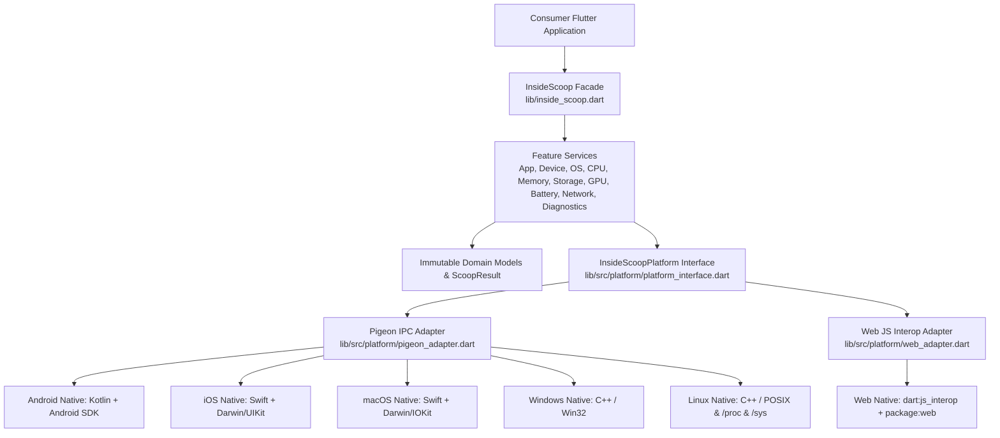

# Architecture: inside_scoop

## 1. Overview & Principles

`inside_scoop` is a fully independent, production-grade Flutter plugin designed to collect system, hardware, operating system, application, and diagnostic metrics across all six Flutter platforms:
- **Android**
- **iOS**
- **macOS**
- **Windows**
- **Linux**
- **Web**

### Core Architectural Principles
- **Strict Independence**: Zero runtime dependencies on existing wrapper packages (such as `package_info_plus`, `device_info_plus`, `battery_plus`, `connectivity_plus`, `system_info_plus`, etc.).
- **Clean Architecture**: Clear separation of concern across public facade, domain feature services, domain models, platform contracts, and native platform bindings.
- **Strongly Typed Results**: A sealed `ScoopResult<T>` structure distinguishes between available data and explicit reasons for unavailability.
- **Safe Sandboxing & Permissions**: Strictly adheres to platform sandboxing guidelines, non-elevated user contexts, and non-invasive privacy practices.

---

## 2. Component Hierarchy

---

## 3. Layer Specifications

### 3.1 Public Surface (`lib/inside_scoop.dart`)
- Provides a clean namespaced facade:
  - `scoop.app`
  - `scoop.device`
  - `scoop.os`
  - `scoop.cpu`
  - `scoop.memory`
  - `scoop.storage`
  - `scoop.gpu`
  - `scoop.battery`
  - `scoop.network`
  - `scoop.diagnostics`
  - `scoop.capabilities()`
- Exposes immutable domain models and the sealed `ScoopResult<T>` hierarchy.

### 3.2 Domain Layer (`lib/src/core/`)
- **Models (`lib/src/core/models/`)**: Pure Dart classes with `@immutable`, value equality (`operator ==`), `hashCode`, `toMap()`, `toJson()`, and `toString()`.
- **Errors & Results (`lib/src/core/errors/`)**:
  - `ScoopResult<T>`: Sealed class with `ScoopAvailable<T>` and `ScoopUnavailable<T>`.
  - `ScoopUnavailableReason`: Distinguishes `unsupportedOnPlatform`, `permissionDenied`, `restrictedBySystem`, `sensorNotPresent`, `temporarilyUnavailable`, and `internalError`.
- **Capabilities (`lib/src/core/capabilities/`)**:
  - `ScoopFeature`: Categorized feature matrix elements.
  - `ScoopCapabilityState`: Represents feature availability at runtime without guessing.

### 3.3 Platform Contract Layer (`lib/src/platform/`)
- **`InsideScoopPlatform`**: Extends `PlatformInterface` with a token verification mechanism.
- Platform implementations register themselves as the active singleton for runtime dispatch.

### 3.4 Native Binding Layer
- **Pigeon**: Compile-time type-safe code generator for Android (Kotlin), iOS/macOS (Swift), Windows (C++), and Linux (C++).
- **Web JS Interop**: Modern `dart:js_interop` combined with `package:web`, ensuring compatibility with both JavaScript and WebAssembly (WASM).
