# Development Plan: inside_scoop

## 1. Roadmap Overview

Development proceeds strictly one feature at a time across all six target platforms (Android, iOS, macOS, Windows, Linux, Web).

```mermaid
flowchart LR
    P0[Phase 0<br/>Foundation] --> P1[Phase 1<br/>App Info]
    P1 --> P2[Phase 2<br/>Device & OS]
    P2 --> P3[Phase 3<br/>Capabilities]
    P3 --> P4[Phase 4<br/>CPU Info]
    P4 --> P5[Phase 5<br/>Memory]
    P5 --> P6[Phase 6<br/>Storage]
    P6 --> P7[Phase 7<br/>GPU Info]
    P7 --> P8[Phase 8<br/>Battery]
    P8 --> P9[Phase 9<br/>Network]
    P9 --> P10[Phase 10<br/>Monitoring]
    P10 --> P11[Phase 11<br/>Diagnostics]
    P11 --> P12[Phase 12<br/>Stabilization]
```

---

## 2. Phase Breakdown & Acceptance Criteria

### Phase 0 — Foundation & Architecture (Current Phase)
- **Scope**: Repository assessment, architectural design, dependency policy, directory layout, error/result taxonomy, and documentation baseline.
- **Acceptance Criteria**:
  - `docs/` artifacts initialized.
  - `ScoopResult<T>`, `ScoopUnavailableReason`, and capability models implemented with unit tests.
  - 100% test pass and zero analysis issues.

### Phase 1 — Application Information
- **Scope**: Retrieve app name, package/bundle ID, app version, build number, and installer metadata.
- **Native APIs**:
  - Android: `PackageManager`, `PackageInfo`
  - iOS/macOS: `Bundle.main.infoDictionary`
  - Windows: `GetModuleFileNameW`, `GetFileVersionInfoW`
  - Linux: `/proc/self/exe`, `.desktop` file parsing
  - Web: `web.window.location`, `web.document.title`

### Phase 2 — Device & Operating System Metadata
- **Scope**: OS name, version, build, device model, manufacturer, system architecture, non-sensitive system identifiers.
- **Native APIs**:
  - Android: `Build`, `Build.VERSION`
  - iOS/macOS: `UIDevice`, `ProcessInfo`, `sysctl`
  - Windows: `RtlGetVersion`, `GetNativeSystemInfo`, SMBIOS
  - Linux: `/etc/os-release`, `uname()`, `/sys/class/dmi/id/`
  - Web: `navigator.userAgentData`, `navigator.userAgent`

### Phase 3 — Capability Detection
- **Scope**: Query feature and sensor availability dynamically across all platforms without false assumptions.

### Phase 4 — CPU Information
- **Scope**: CPU model, architecture, logical and physical core count, static clock frequency, dynamic utilization.

### Phase 5 — Memory (RAM) Information
- **Scope**: Total system memory, available memory, process resident memory, virtual memory metrics.

### Phase 6 — Storage Information
- **Scope**: Volume capacity, free storage, application storage usage, browser storage estimate (explicitly tagged).

### Phase 7 — GPU Information
- **Scope**: GPU vendor, model, graphics API, dedicated/shared VRAM where accessible.

### Phase 8 — Battery & Power
- **Scope**: Battery percentage, charging status, power source, thermal status, battery presence check.

### Phase 9 — Network Information
- **Scope**: Network interface categories (WiFi, Cellular, Ethernet, VPN), active interface status, connection changes.

### Phase 10 — Real-time Monitoring
- **Scope**: Lifecycle-aware streams with configurable intervals, debouncing, and automated resource release.

### Phase 11 — Diagnostics & Reporting
- **Scope**: Structured JSON diagnostic snapshots, redaction of sensitive info, schema versioning.

### Phase 12 — Stabilization & Publication Readiness
- **Scope**: Six-platform verification matrix, full test suite, documentation audit, pub.dev dry-run verification.
